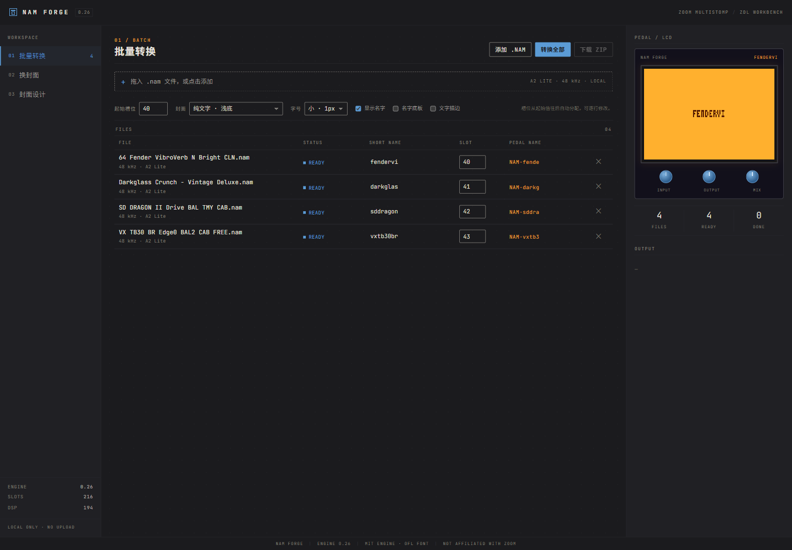
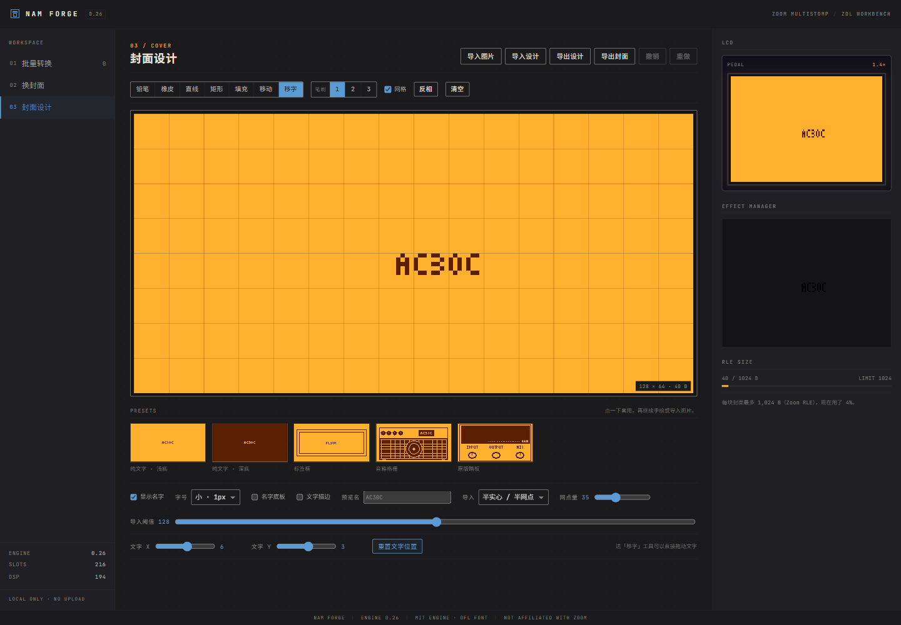
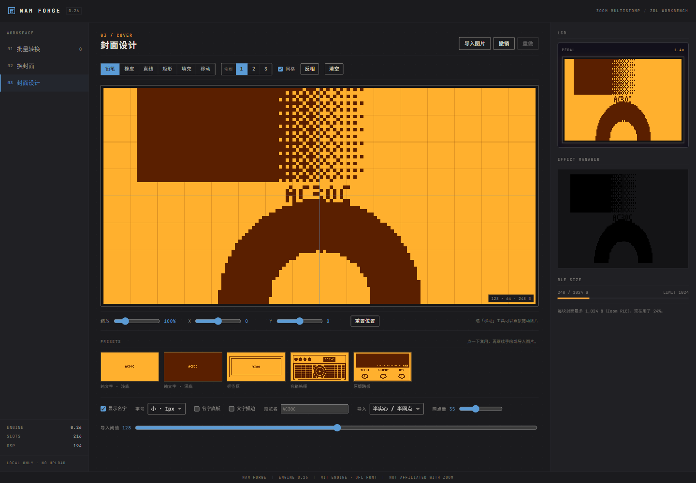

# NAM FORGE · Zoom MultiStomp ZDL Workbench

[English](README.md) · [中文](README.zh-CN.md)

Turn NAM (Neural Amp Modeler) captures into Zoom MultiStomp `.ZDL` effects for the **MS-50G / MS-60B / MS-70CDR**, and design 128×64 1-bit covers. The UI palette is inspired by the **Zoom G1on**.

Runs entirely in the browser. Files never leave your machine.

> The app UI is Chinese-first. This README is in English.

## Compatibility

- **Zoom MultiStomp MS-50G / MS-60B / MS-70CDR** (original models; not the “+” series or the Four series).
- **Zoom G1on**: visual/hardware reference only (amber LCD, blue knobs, gray-black panel). The G1on itself is not a target device for these ZDLs.
- **NAM / Neural Amp Modeler**: A2 Lite captures (`.nam`, SlimmableContainer, 3-channel WaveNet).
- **Output**: `.ZDL` effects for **Zoom Effect Manager 2.3.3+**.

## Shared covers

Browse community covers in [NAM FORGE COVERS](https://zisonzishen0415-stack.github.io/nam-forge-covers/). Download a design JSON from the library, then use **封面设计 → 导入设计** in the app.

**Share from the app**: in the cover editor, click **分享到共享库**, fill in name/author/license/source and click **分享**. The app packs the design into a prefilled GitHub issue; click **Submit new issue** once. No token and no exports. A GitHub Action validates it and adds the design JSON + 128×64 PNG to `library.json` automatically.

## Features

- **Batch conversion** — drop multiple `.nam` files; the app detects A2 Lite models (3-channel WaveNet inside a SlimmableContainer), assigns short names and slots, and exports a ZIP with `.ZDL` + matching `.png` + `.json` notes.
- **Cover library** — save multiple edited covers from the Cover designer (stored in this browser's localStorage). In the Batch and Re-cover tables, click a row's cover thumbnail to pick a cover just for that file (library, built-in preset, or the current edit); one button resets everything to the default cover.
- **Re-cover** — drop existing `.ZDL` files; only the 1,024 B picture area and 12 B display name are rewritten. Weights, FXID and version are left untouched (byte-diff verified). Each file can use its own cover.
- **Cover designer** — 128×64 1-bit; default “plain text on light” with 1 px small text; presets, freehand drawing, invert, clear. The “original pedal” preset draws no name by default; enable “show name” if you want it.
- **Image import** — half-solid / half-dither hybrid (default, dot amount adjustable), pure dither, solid, or line/edge mode; scale 25–400%, X/Y offset, or drag with the Move tool. Artwork is fitted to the pedal's display shape (LCD pixels are 1.4× taller than wide), so it is not stretched on the ZDL.
- **What you see is what you get** — editor, pedal previews, thumbnails and the exported PNG all use the pedal's real 1.4× shape.
- **Text** — show/hide, small 1 px or large, X/Y offset or drag with the Move-text tool; optional plate and outline.
- **Import / export** — export the cover as a 128×64 PNG; export/import the full design as JSON (bitmap + text position/size/toggles), so you can continue on another machine.
- Engine **0.26**, **216** capture slots, **194 DSP** per full-rate capture.

## Quick start

1. Download or clone this repo and open `index.html` in Chrome or Edge.
2. No server, no network: files are processed locally in the browser.
3. Or use the GitHub Pages build: <https://zisonzishen0415-stack.github.io/nam-forge/>

## Convert

1. **Batch** → drop multiple `.nam` files.
2. Start slot defaults to **40** and can be changed per row (any value 1–216).
3. **Convert all** → **Download ZIP**.
4. Each capture gets `NAM<slot><shortname>.ZDL`, a matching `.png` (Effect Manager thumbnail), and `NAMLite-<shortname>.json` (conversion notes).

## Re-cover

1. **Re-cover** → drop existing `.ZDL` files (0.26 templates).
2. Edit the display name; click a row's cover thumbnail to pick a cover for that file, then **Apply cover**.
3. Only the cover area and display name change; the amp model data is untouched.

## Install on the pedal

- Use **Zoom Effect Manager 2.3.3+** → Settings → Read Effects from folder → From Folder, pointing at the extracted folder.
- The `.ZDL` and matching `.png` must sit together; **do not rename them** (the pedal only keeps the first 8 characters of the basename, and duplicate names can freeze it).
- Original MultiStomp only: **MS-50G / MS-60B / MS-70CDR**. The “+” models (MS-50G+, MS-60B+, MS-70CDR+) and the Four series are not supported.
- Back up your patches first. A full-rate capture declares 194 DSP; several captures usually cannot run at once.
- If the pedal freezes: unplug it, hold **Up + Down** while plugging in USB to enter update mode, then delete the last installed effect with Effect Manager. As a last resort, `All INITIALIZE` erases all patches.

## Technical notes

- Cover: 128×64, 1-bit, Zoom column-major RLE, 1,024 B capacity.
- Names: 3×5 pixel font; only A–Z, 0–9 and `- + / . !`; filenames `NAM<slot><name>` are at most 8 characters.
- Engine 0.26: full rate 194 DSP; 48 kHz sources run on the pedal's 44.1 kHz rate without sample-rate conversion.
- All conversion happens locally in the browser; there is no server and no upload.

## References & credits

- **Palette / hardware reference**: Zoom **G1on** — amber LCD, blue knobs, gray-black panel. Zoom and G1on are trademarks of Zoom Corporation; this project is not affiliated with or endorsed by Zoom.
- **Engine and ZDL/cover format**: [themanro/ZoomMultistompZDL](https://github.com/themanro/ZoomMultistompZDL) — NAMLite 0.26, templates, slot identity and cover encoding. The fork's original work is MIT; see its notes for the upstream [repeat98/ZoomMultistompZDL](https://github.com/repeat98/ZoomMultistompZDL).
- **NAM format**: [NeuralAmpModelerCore](https://github.com/sdatkinson/NeuralAmpModelerCore) (Steven Atkinson, MIT).
- **Font**: [JetBrains Mono](https://github.com/JetBrains/JetBrainsMono) (SIL Open Font License 1.1), embedded in the page; see `FONT-LICENSE.txt`.
- **Installer**: Zoom Effect Manager (third-party; not bundled).

Third-party notices and the full MIT/OFL texts are in `NOTICE.txt` and `FONT-LICENSE.txt`.

**Keywords:** Zoom MultiStomp, Zoom G1on, MS-50G (MS50G), MS-60B (MS60B), MS-70CDR (MS70CDR), NAM, Neural Amp Modeler, NAM capture, NAMLite, `.nam`, `.ZDL`, ZDL, Zoom Effect Manager, amp modeling, guitar, bass, multi-effects, effect pedal.

## Disclaimer

- This is not an official Zoom Corporation product and is not endorsed or supported by Zoom.
- Custom effect files can freeze or prevent the pedal from booting; back up your patches and use at your own risk.
- Engine templates and formats come from the open-source projects above. NAM captures are supplied by the user; no captures are bundled.
